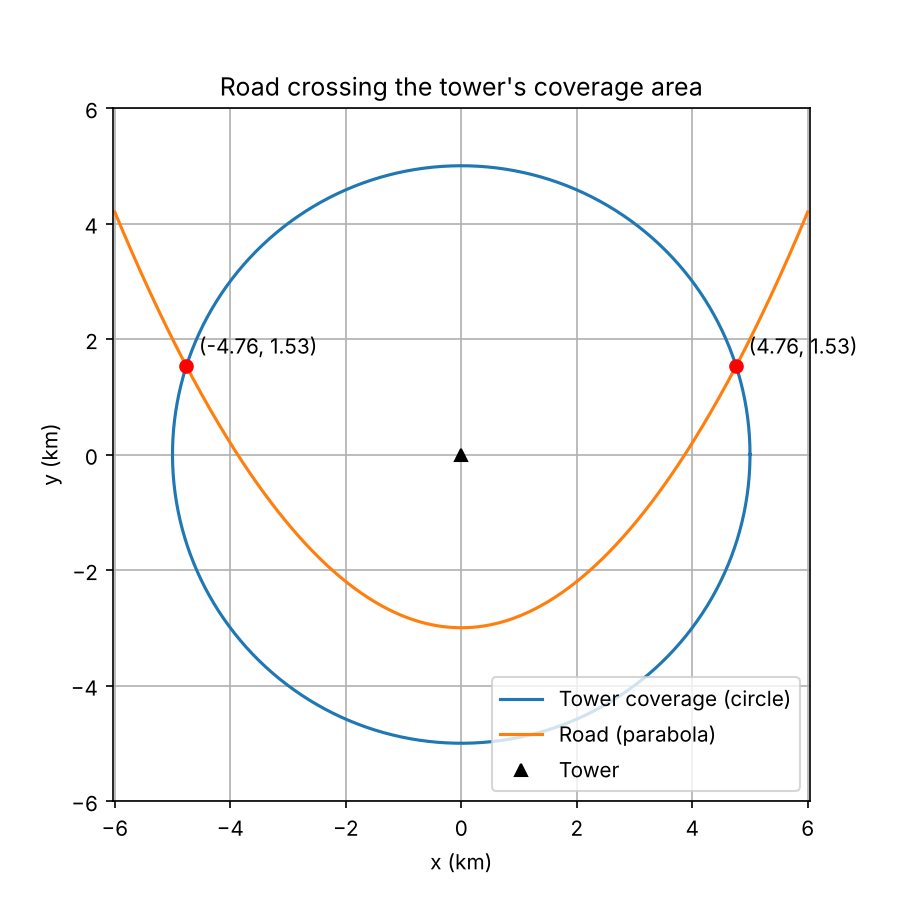

# BIT 2118 Scientific Computing: Task K (Polynomial and Nonlinear Equation Solving)

## 1. Original program: `code/Task_12_nonlinear_equations.py`

**Problem:** find where a circle and a parabola intersect.
- Circle: x² + y² = 4
- Parabola: y = x² − 1

**Inputs**
- Two equations written as *residuals* (each is zero when the equation is satisfied):
  `x² + y² − 4` and `y − (x² − 1)`
- Two initial guesses: `[1.0, 1.0]` and `[-1.0, 1.0]`

**Mathematical operations**
1. `equations(z)` returns the two residuals for a candidate point (x, y).
2. `scipy.optimize.root` starts at the initial guess and repeatedly adjusts (x, y) so both residuals shrink towards zero.
3. The residuals of the answer are printed to verify it. Values near 1e-13 mean both equations are satisfied.
4. `solution.success` says whether the solver converged.

**Output**

```
Initial guess: [1.0, 1.0]
Intersection: [1.51748991 1.30277564]
Residuals: [-2.5e-13, -2.4e-13]
Converged: True

Initial guess: [-1.0, 1.0]
Intersection: [-1.51748991  1.30277564]
Residuals: [-2.5e-13, -2.4e-13]
Converged: True
```

**Meaning of the output:** the circle and parabola cross at two points, (1.5175, 1.3028) and (−1.5175, 1.3028). The residuals are essentially zero, so both equations hold at those points. Each initial guess leads to a different intersection, which is why a solver is started from more than one guess.

**Check by algebra:** substituting x² = y + 1 into the circle gives y² + y − 3 = 0, so y = (−1 + √13)/2 ≈ 1.3028. The other root, y ≈ −2.3028, would need x² = −1.3028, which is impossible for real x. So there are exactly two real intersections, matching the solver.

## 2. Parameter changes (one change at a time)

| Run | Change | Result | Converged |
|---|---|---|---|
| 0 | Original (r² = 4, y = x² − 1) | (±1.5175, 1.3028) | True |
| 1 | Circle r² = 9 (bigger circle) | (±1.8364, 2.3723) | True |
| 2 | Circle r² = 1 (smaller circle) | (±1, 0) and also (0, −1): three intersections | True |
| 3 | Circle r² = 0.5 (too small) | No intersection exists | False |
| 4 | Parabola y = x² (shifted up by 1) | (±1.2496, 1.5616) | True |
| 5 | Initial guess `[0, -2]` | Lands on (0, −2), residual about 1 | False |

**Explanations**
- **Bigger circle:** the circle reaches further out, so the crossing points move out along the parabola, to larger x and y.
- **Smaller circle (r² = 1):** the circle just touches the bottom of the parabola, giving a third intersection at (0, −1). A third solution is only found from a guess near it, such as `[0.1, -0.9]`.
- **Circle too small (r² = 0.5):** the two curves never meet, so no solver can succeed. `success` is False and the residuals stay large. A solver can only find solutions that exist.
- **Parabola shifted up:** the parabola crosses the circle higher up and closer to the y-axis, so x gets smaller and y gets larger.
- **Bad initial guess:** the solver stops at a point that is not a solution. This is why you check `success` and the residuals, and why you try several starting points.

## 3. Modified program: `code/Task_12_modified.py` (road crossing a mobile tower's coverage area)

**Real-world case:** a mobile network tower covers a circular area. A curved road passes near the tower. Where does the road enter and leave the coverage area? This tells you which stretch of road has signal.

**New assumptions** (illustrative values, not measured data)
- The tower is at the origin (0, 0) and covers a circle of radius R = 5 km: x² + y² = 25.
- The road is shaped like a parabola: y = 0.2x² − 3 (km).
- Coverage is a perfect circle, with no hills or buildings blocking the signal.
- The road is treated as a smooth curve in a flat plane.

**Input data**
- R = 5.0 km, a = 0.2, c = −3.0
- Initial guesses: `[4, 1]`, `[-4, 1]`, `[0, -5]`

**Output**

```
Coverage boundary crossings (x, y) in km:
  (4.760, 1.531)
  (-4.760, 1.531)
Horizontal distance between the two crossings: 9.520 km
```

The third guess `[0, -5]` did not converge (`Converged: False`), so the program ignores it and does not list it as a crossing.



**Interpretation:** the road enters the tower's coverage area at x = −4.76 km and leaves it at x = +4.76 km, each time at a height of about 1.53 km. Between the two red points the road is inside the coverage area, over a horizontal span of about 9.5 km. Outside them, the road has no signal. A network planner could use this to decide where a second tower is needed. The result depends on the assumed numbers, so real measurements of the road and the tower's range would be needed before relying on it.

## 4. How to run

```
pip install numpy matplotlib scipy
python code/Task_12_nonlinear_equations.py
python code/Task_12_modified.py
```
